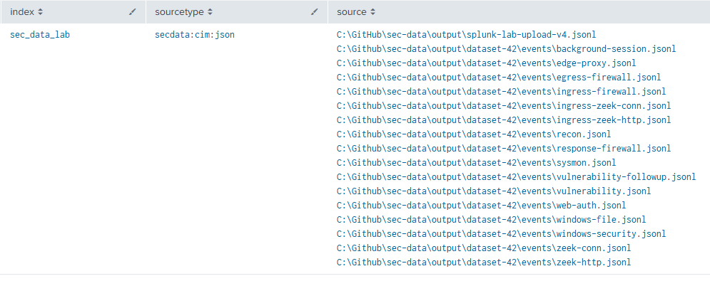

# Local Splunk CIM validation

This report records live checks on the 291-record CIM projection fixture, which includes duplicate DNS views and scripted alert and case records. The primary `create_dataset.py` package selects 274 of those observations and can add linked background sessions to an exact requested count; see the [dataset guide](dataset.md). The package layout was checked locally. The live field and data-model results below apply to the planted fixture, not to the high-volume background stream.

Validated on 2026-11-03 with Splunk Enterprise 10.4.0, Splunk Common Information Model add-on 8.7.0, and `TA-sec-data-cim` 0.1.2. The deterministic story uses seed 42 and starts at `2026-10-22T12:00:00Z`. Its 18 projected source files are committed in `tests/fixtures/cim-story-42/` (291 JSON records, 145,035 bytes total). All 18 were regenerated byte for byte from the checked-in `tests/fixtures/story-seed42/` source bundle. Five of the 296 source observations are intentionally unmapped.

The files were combined in chronological order for a one-time upload to a temporary lab index with `sourcetype=secdata:cim:json`. The final combined file's SHA-256 was `108b556a5f40da7943aec13370675ca784887577d7cf9a13b3e68b895c6b5162`. Splunk assigned one `host`, `source`, and `splunk_server` value to that upload. The `sec_data_source` field preserves the originating generator file for each record. Search examples below target the current `sec_data` index; the measured results in this report came from the earlier isolated upload.

## Source inventory in the Splunk UI



This screenshot uses an earlier temporary index name. Use `sec_data` for new uploads. It shows the 16 event files in the earlier dataset design and a separate combined fixture upload. The current reference run produces 19 source files; see the [current source inventory](dataset.md#expected-source-inventory-in-splunk). The image illustrates the Splunk view, while the measurements below came from the isolated 291-event fixture.

| CIM data model dataset | Expected | Indexed | Model search |
| --- | ---: | ---: | ---: |
| `Alerts.Alerts` | 2 | 2 | 2 |
| `Authentication.Authentication` | 10 | 10 | 10 |
| `Change.All_Changes` | 1 | 1 | 1 |
| `Data_Access.Data_Access` | 3 | 3 | 3 |
| `Endpoint.Filesystem` | 2 | 2 | 2 |
| `Endpoint.Processes` | 11 | 11 | 11 |
| `Endpoint.Registry` | 1 | 1 | 1 |
| `Network_Resolution.DNS` | 16 | 16 | 16 |
| `Network_Traffic.All_Traffic` | 82 | 82 | 82 |
| `Ticket_Management.All_Ticket_Management` | 7 | 7 | 7 |
| `Vulnerabilities.Vulnerabilities` | 136 | 136 | 136 |
| `Web.Web` | 20 | 20 | 20 |
| **Total** | **291** | **291** | **291** |

Splunk indexed 291 separate events after restart. All 291 JSON records exposed `sec_data_cim_dataset` at search time. The largest `_raw` event was 662 characters; no multiline event remained. `_time` matched the source `time` for every event (maximum absolute difference 0 seconds), from 2026-10-22 11:59:00 to 12:47:56 UTC. The check used `%Z` to parse the `Z` timezone marker; treating it as a literal would produce a five-hour comparison error on the Central time search host.

All 16 DNS events had `query`, `src`, `dest`, and `reply_code`. All 10 authentication events had `user` and `action`. All 20 Web events had `url`, `http_method`, and `status`. All 11 Endpoint Processes events had `process` and `process_id`; all 7 ticket events had `ticket_id` and `status`. Some optional fields remain absent where the source does not support them: 32 Network Traffic events had no `action`, five Sysmon network events had no `bytes`, and three recon process events had no `action`. These are mapping abstentions rather than extraction failures.

All seven ticket events preserve `trigger_alert_id`, and the ID resolves to one of the two indexed alerts. Two ticket events preserve `finding_id`, two preserve `change_id`, and one preserves `target_ip`. These are observed source references for direct-event investigation; the CIM ticket model does not select them into its result set.

The Zeek connection for the finance upload has `bytes_out=4476`, `bytes_in=320`, and `bytes=4796`, consistent with the firewall projection's outbound/inbound direction. The Windows 5145 payroll share check has `action=unknown`, `access_result=failure`, and `requested_action=read`; it is not counted as a successful read. The two Windows 4663 records have `action=read` and `access_result=success`. The access-result and requested-action fields are project context outside the CIM Data Access model result set.

The `Network_Resolution.DNS` count includes two views of each of eight transactions: eight from `dns.log` and eight from `recon.jsonl`. For a dataset where each transaction should appear once, ingest only one view. The installed CIM add-on also matched 19 records with its broad `err0r` event type and `error` tag; the project-owned event types and all twelve intended model counts still matched.

The first DNS field check found a real extraction failure: `KV_MODE=json` exposed array values as `answer{}` and `ttl{}`, leaving the intended CIM fields empty. `TA-sec-data-cim` 0.1.2 now supplies search-time `EVAL-answer` and `EVAL-ttl` mappings. In the story fixture, `answer_count` matches the number of extracted answers on all 16 DNS events and ten have observed TTL values. A separate 505-byte edge fixture, `tests/fixtures/cim-dns-multianswer.jsonl`, produced two `answer` values, two `ttl` values, `answer_count=2`, and membership in `Network_Resolution.DNS`. That temporary event was marked deleted from search afterward, leaving the 291-event story visible.

Numeric checks found zero invalid `response_time`, `reply_code_id`, or `query_count` values in DNS; zero invalid `bytes` or `duration` values and zero directional-byte sum mismatches in Network Traffic; and zero invalid `cvss` values or malformed emitted CVE IDs in Vulnerabilities. The field profile, including conditional and out-of-model fields, is in [CIM field decisions](cim-fields.md).

The ten effective `cim_*_indexes` macros used by these twelve datasets all have the CIM add-on's default empty definition `()`. The DNS model search string expanded the index predicate to `index=* OR index=_*`; the live model searches proved the temporary validation index was included. This broad default also covers `sec_data`, but this report does not establish a separate data-model test in that index.

## Validation matrix

| Check | Result | Evidence |
| --- | --- | --- |
| Fixture reproduction | Pass | All 18 CIM files regenerated byte for byte from the checked-in source story. |
| Event boundaries and count | Pass | 291 visible JSONL events; largest `_raw` event 662 characters; all twelve counts match. |
| UTC event time | Pass | 291 parsed; maximum `_time` difference 0 seconds. |
| Scalar field extraction and types | Pass for tested fields | DNS, authentication, Web, process, ticket, traffic byte, and vulnerability checks above. |
| Multivalue DNS fields | Pass | `answer{}` and `ttl{}` mapped; two-answer edge event preserved both values. |
| Case-to-alert linkage | Pass | Seven ticket events expose `trigger_alert_id`; it matches an indexed alert ID. |
| Byte direction and denied access | Pass | Zeek finance upload is 4476 outbound/320 inbound; payroll 5145 is a failed check, not a read. |
| Event types, tags, and CIM membership | Pass | All twelve project event types match the expected counts; all twelve official data-model searches match. |
| Index macro inclusion | Pass | Ten effective macros are `()`; live model searches included the temporary validation index. |
| Investigation and detection searches | Pass | Probe burst, authentication pattern, read/POST candidates, and alert-to-case-to-block sequence below. |
| Vendor raw-event parsers and exhaustive CIM semantics | Outside this test | Source-shaped formats and fields not selected by these models need separate validation. |

## Example validation searches

Use **All Time** because the fixture event times are in October 2026. The searches below use `sec_data`. To reproduce the 291-event counts above, load only the committed fixture into a clean test index and substitute that index name in each search. Counts will differ if `sec_data` also contains a generated dataset. Count the indexed records:

```spl
index=sec_data sourcetype=secdata:cim:json
| stats count by sec_data_cim_dataset
| sort sec_data_cim_dataset
```

Check timestamps, including the UTC marker:

```spl
index=sec_data sourcetype=secdata:cim:json
| eval expected_time=strptime(time,"%Y-%m-%dT%H:%M:%S.%3N%Z")
| eval delta=abs(_time-expected_time)
| stats count max(delta) as max_delta count(eval(isnull(expected_time))) as unparsed_time
```

For each row above, substitute its model and dataset in this query:

```spl
| datamodel Network_Resolution DNS search
| search sourcetype=secdata:cim:json
| stats count
```

Use `sourcetype` for the post-model filter. The model's result fields do not include `index`, so filtering on `index` after `datamodel ... search` gives a false zero.

Check DNS arrays and unit conversion. The story result was `count=16`, `answer_count_mismatch=0`, and `ttl_events=10`:

```spl
index=sec_data sourcetype=secdata:cim:json sec_data_cim_dataset="Network_Resolution.DNS"
| eval answer_items=coalesce(mvcount(answer),0)
| stats count count(eval(answer_items!=answer_count)) as answer_count_mismatch count(eval(isnotnull(ttl))) as ttl_events count(eval(NOT isnum(response_time))) as nonnumeric_response_time
```

The edge fixture was checked before deletion with `event_id=dns-multivalue-1 | eval answer_items=mvcount(answer),ttl_items=mvcount(ttl) | table answer answer_count answer_items ttl ttl_items response_time`. It returned `answer_items=2`, `ttl_items=2`, and `response_time=0.041` seconds.

The following investigation searches ran against the visible story. A ten-second distinct-port search found four windows with at least three ports for `203.0.113.50`, including the planted network probe burst:

```spl
index=sec_data sourcetype=secdata:cim:json sec_data_cim_dataset="Network_Traffic.All_Traffic" src=203.0.113.50
| bin _time span=10s
| stats dc(dest_port) as distinct_ports count as connections by src _time
| where distinct_ports>=3
```

An authentication investigation returned `LAB\operator` with four failures, one success, and source IPs `203.0.113.50` and `10.10.6.32`:

```spl
index=sec_data sourcetype=secdata:cim:json sec_data_cim_dataset="Authentication.Authentication"
| stats count(eval(action="failure")) as failures count(eval(action="success")) as successes values(src) as src_values by user
| where failures>=3 AND successes>=1
```

A one-minute successful-read/POST correlation returned two candidates: at 12:39 UTC, a read of `Q4-forecast.csv` before `files.example.net/api/upload`; at 12:42 UTC, a read of `backup-manifest.json` and `backup.example.net/api/upload`. The denied `payroll.csv` check is excluded. The second candidate shows why the object inventory and approved backup context matter. The search does not establish which file bytes were uploaded:

```spl
index=sec_data sourcetype=secdata:cim:json (sec_data_cim_dataset="Data_Access.Data_Access" OR sec_data_cim_dataset="Web.Web")
| bin _time span=1m
| stats count(eval(sec_data_cim_dataset="Data_Access.Data_Access" AND action="read")) as reads count(eval(sec_data_cim_dataset="Web.Web" AND http_method="POST")) as posts values(eval(if(action="read",object,null()))) as objects values(url) as urls by _time
| where reads>0 AND posts>0
```

Finally, this query returned nine ordered events: the sensitive-read alert, seven case actions from `opened` through `verified`, and a firewall `blocked` event immediately after `contained`:

```spl
index=sec_data sourcetype=secdata:cim:json (signature_id=sensitive-read-outbound OR sec_data_cim_dataset="Ticket_Management.All_Ticket_Management" OR sec_data_source=response-firewall.jsonl)
| eval when=strftime(_time,"%Y-%m-%dT%H:%M:%S.%3N%z")
| table when sec_data_cim_dataset signature_id action status rule
| sort when
```

The case actions can also be joined to their alert without relying on their time alone:

```spl
index=sec_data sourcetype=secdata:cim:json (sec_data_cim_dataset="Alerts.Alerts" OR sec_data_cim_dataset="Ticket_Management.All_Ticket_Management")
| eval ref=coalesce(id,trigger_alert_id)
| stats count values(sec_data_cim_dataset) as datasets by ref
```

The shared `ref` has one alert and seven ticket actions; the other alert has no ticket actions in this fixture.

## Scope and known local warnings

The first upload on 2026-10-25 occurred before the index-time parser had restarted and grouped 291 lines into 35 events. Those 35 failed test events were marked deleted from search in the dedicated lab index. A corrected 144,287-byte upload and 505-byte DNS edge test ran on 2026-11-03. Revisions preserving case links (144,895 bytes) and correcting Zeek byte direction and denied access (145,035 bytes) were each ingested after marking the previous upload deleted from search. Only the final 291-event story remains visible. These uploads total less than 0.6 MB, well below the 500 MB/day limit. The `delete` search command does not reclaim index storage or license volume.

The local Splunk startup also reported an invalid broad regex stanza in `TA-virustotal-app` and invalid keys in other pre-existing apps. The regex is outside `TA-sec-data-cim`; this fixture's line breaking and model searches passed. The warning may matter for other indexing or summary workloads and was not changed during this validation.

This test proves ingestion, timestamp extraction, search-time tags, selected fields, and membership in the twelve intended CIM 8.7.0 datasets for this fixture. It does not establish vendor raw-event compatibility, exhaustive field semantics, or behavior on other CIM versions.
